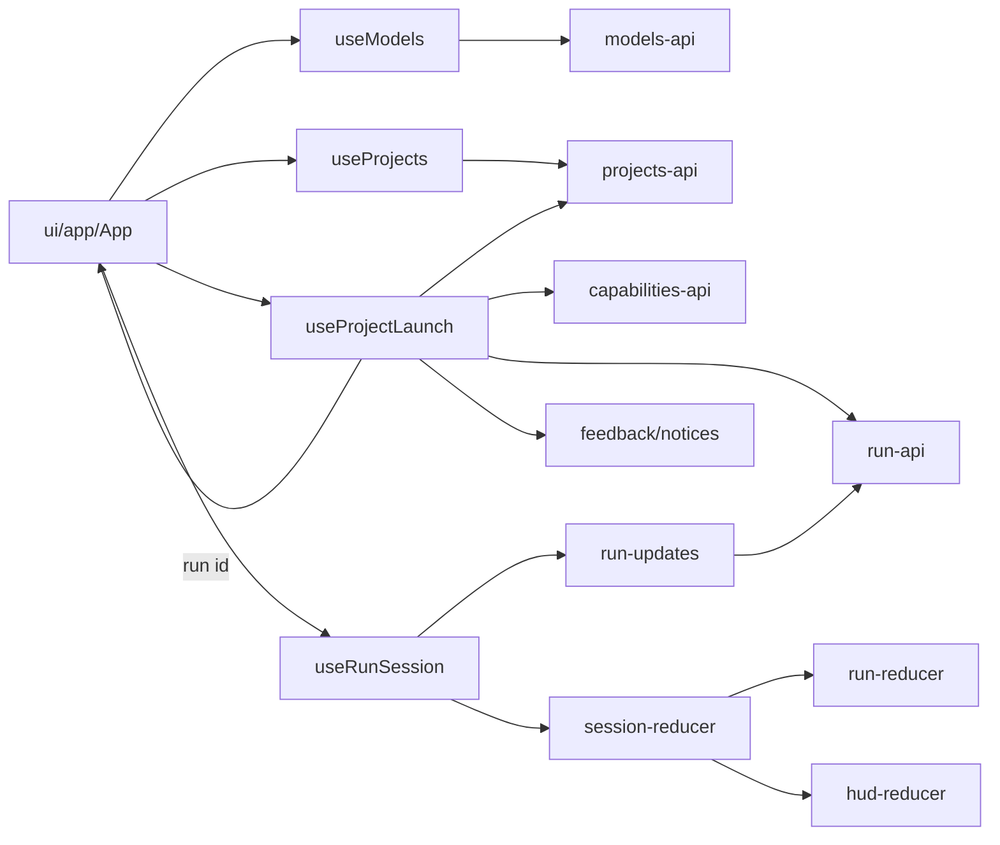

# Desktop renderer architecture

The renderer is a React application that talks to the Python API over HTTP and
SSE. State lives in **owners**: hooks that hold one domain's data and request
lifetimes. Components render props and call owner operations. Update this file
whenever an owner or a dependency rule changes.

## Folders

Rendered `.tsx` components and their CSS live under `ui/`, grouped by feature.
TypeScript hooks, contracts and state live in the matching folders outside `ui/`.

| Folder | Responsibility |
| --- | --- |
| `ui/` | All rendered components and CSS: app composition, backend startup, the HUD frame, projects and the run view. |
| `app/` | Standalone preview data. |
| `backend/` | IPC connection discovery and HTTP readiness hooks. |
| `projects/` | Project requests and validation, interim selection and creation state, and the launch command. |
| `capabilities/` | Capability catalogue and saved-selection requests, and selection resolution. |
| `models/` | Model requests and validation, and the acknowledged backend selection. |
| `run/` | Run contracts, requests, payload decoding, event reconciliation and live updates. |
| `session/` | The displayed run's subscription lifetime and the atomic composition of run data with HUD state. |
| `hud/` | Message projection, history, display selection and layout logic. |
| `feedback/` | Error notices any owner can raise. |
| `api/` | Shared HTTP/SSE transport, request deadlines and React request state. |
| `assets/` | Bundled Anurati status-mark font. |

## Owners

| Owner | Holds | Requests |
| --- | --- | --- |
| `models/useModels` | Confirmed model selection | Catalogue read, selection write |
| `projects/useProjects` | Project rows, interim selection, name draft | List, create |
| `projects/useProjectLaunch` | One pending launch | Create project, read and save capabilities, create run |
| `session/useRunSession` | The displayed run (`RunSession`) | Stream and snapshot polling (`run/run-updates`) |
| `feedback/notices` | Visible error notices | None |

`ui/app/App.tsx` composes the owners and keeps view, draft, divider layout and
focus. Owners do not import each other; App passes results between them, as when
a launch hands its new run to `useRunSession.open`.

## Rules

- **Direction.** `ui/` imports owners; owners and feature modules never import
  `ui/`. Shared `api/` imports no feature module. HUD projection consumes
  validated run data, while run reconciliation has no HUD dependency.
- **Contracts.** Exported functions and hooks declare their return types, using
  named interfaces for structured results (`docs/code-style.md`).
- **Endpoints.** Feature API modules own endpoint paths and payload validation.
  Reducers do no I/O.
- **Request lifetimes.** Every request runs under an `AbortSignal` owned by the
  hook that started it and a deadline from `api/request.ts`. A client change or
  unmount aborts it, and late results are ignored. `withDeadline` also ends the
  operation's signal when it settles, so parallel reads cannot outlive a failure.
- **Writes.** A write is sent once per user action and never repeated
  automatically. After a failure, the owner reads again instead. Multi-step
  commands report each completed write (such as a created project) so that
  trying again does not repeat it.
- **Errors.** Owners raise `showErrorToast` from `feedback/notices`; the notices
  row renders them until a CSP-compatible toaster replaces it.

## The message log

The web keeps one large session store because its terminal is always on screen.
The desktop shows the message log only occasionally, so it keeps no log state:
`run-reducer` already retains every durable event of the displayed run, and the
HUD keeps only its own projection. The log is a pure selector over those events,
computed only while the log pane is mounted (roadmap step 13).
