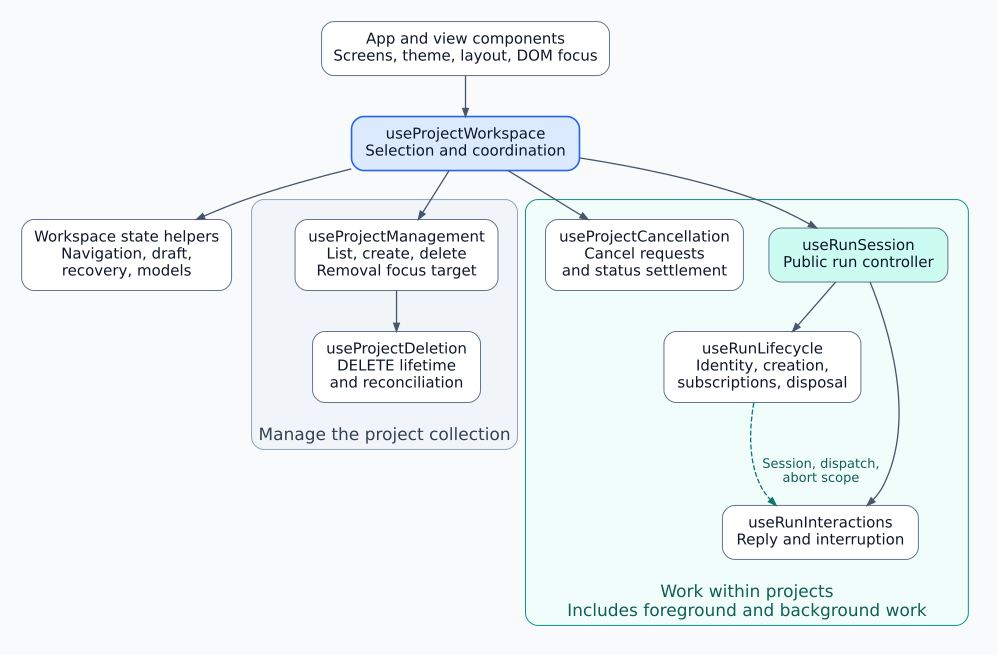
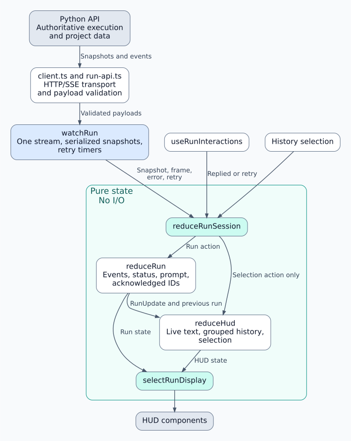

# Renderer ownership and boundaries

The renderer uses layered architecture organized by domain responsibilities.
`App` creates one workspace. The workspace coordinates project management and
work within projects; feature owners retain their own state and request lifetimes.
Changing views keeps these owners mounted.

## Who controls what

Solid arrows mean composition or delegation. The dashed arrow is the internal
run collaboration contract. State and action callbacks flow back to callers;
those return paths are omitted to keep the ownership map readable.



[Open full-size diagram](diagrams/ownership.svg) · [Editable Graphviz source](diagrams/ownership.dot)

The `ProjectManagement` contract exposes collection actions. `ProjectWork` and
`RunLaunch` expose selection, cancellation and launch/open actions. Views receive
these contracts from the same workspace, so Overview and Current Run share
pending operations. Cancellation can target an unselected project. Creating a
project belongs to collection management; creating a run belongs to run lifecycle.

## State and lifetime owners

| Owner | Owns | Boundary |
| --- | --- | --- |
| [App](ui/app/App.tsx) and `ui/` components | Theme, layout, preview choices and local interaction state such as delete confirmation. | Render feature state and invoke supplied actions; apply DOM focus. |
| [useProjectWorkspace](app/useProjectWorkspace.ts) | Selected project and coordination of launch, cancellation, deletion and recovery. | Combines owners through callbacks and typed results. [Availability helpers](app/run-availability.ts) derive eligibility from their state. |
| [useProjectManagement](projects/useProjectManagement.ts) | Project rows, name draft, listing/creation requests, polling and removal focus target. | Receives local-work guards from the workspace; reports creation, listing and deletion outcomes. |
| [useProjectDeletion](projects/useProjectDeletion.ts) / [useProjectCancellation](projects/useProjectCancellation.ts) | Separate per-project request registries, pending/error state and settlement. | Retain pending operations across view/selection changes. Status listings reconcile uncertain or unfinished work. |
| [useRunLifecycle](session/useRunLifecycle.ts) | Displayed session, launch request, subscription and session abort scope. | A replacement launch has its own lifetime. Closing an old project's session leaves another project's launch intact. |
| [useRunInteractions](session/useRunInteractions.ts) | Reply/interruption requests and their pending/error state. | Inherits the lifecycle scope; returns reply acknowledgement and prompt context. |
| [useRunNavigation](app/useRunNavigation.ts) | View, navigation revision, completion/cancellation return intent and focus destination. | Decides whether an asynchronous outcome may navigate. |
| [useReplyDraft](app/useReplyDraft.ts) | One shared draft and its edit revision. | Decides whether an acknowledged submission may clear that revision. |
| [useRecovery](recovery/useRecovery.ts) | Validated initial recovery record and storage errors. | Persists selection, run/project identity and draft per profile/mode. The workspace decides when to restore/save. |
| [useModels](models/useModels.ts) | Confirmed backend model selection, pending request and explicit retry target. | Launch eligibility consumes confirmed selection. |

## Backend data and HUD state

This diagram follows incoming data. The lifecycle stores the combined
`{ run, hud }` session through `useReducer`. The session reducer calls run
reconciliation first, then projects its accepted update into HUD state atomically.
History selection takes the HUD-only path.



[Open full-size diagram](diagrams/run-data-flow.svg) · [Editable Graphviz source](diagrams/run-data-flow.dot)

[Run reconciliation](run/run-reducer.ts) has no HUD dependency.
[HUD projection](hud/hud-reducer.ts) consumes run data, while
[session composition](session/session-reducer.ts) joins the two. Reducers perform
no I/O. [watchRun](run/run-updates.ts) owns read recovery; closing/replacing the
subscription disposes its requests and timers. Replies and interruption inherit
the session scope and cannot apply late results after that scope is aborted.
Confirmed missing runs also end that scope, retaining reducer state for local
history. Temporary outages retain the scope and retry reads.

## Transitions that cross owners

| Operation | Coordination rule |
| --- | --- |
| Reply | Workspace calls `draft.submit(run.reply)`. Interactions return `ReplyResult`; the draft clears only an acknowledged, unchanged revision whose prompt has not been replaced. A consumed prompt can still receive a successful acknowledgement. |
| Launch | Workspace captures `beginLaunch()`, awaits lifecycle creation, then calls `finishLaunch(intent, runId)`. Navigation opens the run only if no subsequent navigation superseded the intent. |
| Cancel | Workspace sends the project action through cancellation. Management supplies fresh listings; workspace passes them to cancellation reconciliation. Navigation returns from Current Run only for its matching pending cancellation or watched run completion. |
| Delete | Management reports `ProjectRemoval`. Workspace clears matching selection and asks lifecycle to close that project's session. If a session was removed, navigation repairs Current Run and supplies the removal focus target to the overview. Other views and the draft survive. |
| Reopen | After readiness, workspace restores saved identity through lifecycle. The watcher validates the run before subscribing; history and prompts come from the backend. Confirmed absence ends the session's request scope, returns Current Run to Overview and removes its saved identity. The draft and any local history survive; relaunch is explicit. Other chosen views stay open. |

## External boundaries

- Feature APIs ([projects](projects/projects-api.ts), [runs](run/run-api.ts),
  [models](models/models-api.ts)) own endpoint paths and response validation.
  Shared [transport](api/client.ts), [request state](api/useRequest.ts) and
  [deadlines](api/request.ts) know nothing about navigation or domain owners.
  Reads may reconnect; HTTP writes require an explicit user action and are never
  automatically repeated.
- The backend owns actual execution, background syncing, project files and
  deletion safeguards. Renderer eligibility and pending state represent local
  knowledge; acknowledgements, snapshots and project listings reconcile it.
- Electron main owns the native window, splash and Docker lifecycle. Renderer
  [startup discovery](backend/useBackendStartup.ts) uses the restricted preload
  bridge; [readiness](backend/useBackendReadiness.ts) and feature traffic use HTTP.
  Readiness Retry does not restart Docker. [BackendStartup](ui/backend/BackendStartup.tsx)
  keeps the mounted workspace alive through outages after its first opening.

Keep feature modules independent of `ui/`, and keep shared `api/` independent of
features. Add cross-owner coordination to the workspace and explicit result
contracts to the relevant owner. Update this map and the compact source map in
`useProjectWorkspace.ts` when those responsibilities change. Regression commands
and boundary scenarios are in [Testing](../../../docs/testing.md).

## Updating the diagrams

The diagrams are embedded SVG images, so Markdown previews can display them
without a Mermaid extension or JavaScript. Their explicit background and text
colours keep them readable in light and dark previews. Edit the linked `.dot`
sources, then regenerate the committed SVGs with Graphviz from the repository
root:

```sh
dot -Tsvg desktop/renderer/src/diagrams/ownership.dot \
  -o desktop/renderer/src/diagrams/ownership.svg
dot -Tsvg desktop/renderer/src/diagrams/run-data-flow.dot \
  -o desktop/renderer/src/diagrams/run-data-flow.svg
```

Open both rendered images after regeneration and check labels, arrows and group
boundaries before committing. Graphviz is only needed to edit these diagrams;
the application has no dependency on it.
