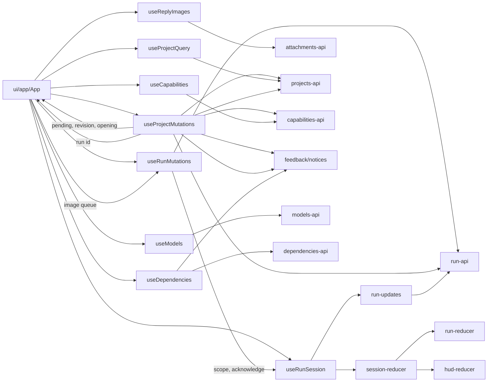

# Desktop renderer architecture

The renderer is a React application that talks to the Python API over HTTP and
SSE. State lives in **owners**: hooks that hold one domain's data and request
lifetimes. Components render props and call owner operations. Update this file
whenever an owner or a dependency rule changes.

## Folders

Rendered `.tsx` components and their CSS live under `ui/`, grouped by feature.
TypeScript hooks, contracts and state live in the matching folders outside `ui/`.

| Folder | Responsibility |
| --- | --- |
| `ui/` | All rendered components and CSS: app composition, backend startup, the HUD frame, the overview and capability selector, and the run view. |
| `app/` | The navigation reducer (screen and launch draft) and standalone preview data. |
| `backend/` | IPC connection discovery and HTTP readiness hooks. |
| `projects/` | Project requests and validation, the overview rows (query) and this app's cancel and delete requests (mutations), and the launch command. |
| `capabilities/` | Capability catalogue and saved-selection requests, the selector's reads, and selection resolution. |
| `models/` | Model requests and validation, and the acknowledged backend selection. |
| `run/` | Run contracts, requests, payload decoding, event reconciliation and live updates. |
| `session/` | The displayed run's subscription lifetime and the atomic composition of run data with HUD state. |
| `hud/` | Message projection, history, display selection and layout logic. |
| `dependencies/` | Dependency monitor records and Check Now requests and validation, and the view's owner. |
| `environment/` | Saved settings and secrets requests and validation, the screen's owner and its editor state. |
| `credentials/` | Secrets status, unlock and remove requests, and the locked-secrets notice. |
| `attachments/` | Image staging requests for a run's next reply, and the reply's image queue. |
| `dictation/` | Microphone recording, the audio level, and transcription requests. |
| `links/` | Opening agent links through the desktop bridge, and reporting failures. |
| `feedback/` | Notifications any owner can raise. |
| `theme/` | The document theme and saving it through the bridge. |
| `api/` | Shared HTTP/SSE transport, request deadlines, client lifetimes and React request state. |
| `assets/` | Bundled Anurati status-mark font. |

## Owners

| Owner | Holds | Requests |
| --- | --- | --- |
| `models/useModels` | Confirmed model selection | Catalogue read, selection write |
| `projects/useProjectQuery` | Project rows and the first-load error; shows the rows with the pending writes App passes in (mutations and the opening launch) | Listing poll while visible, again after each write |
| `projects/useProjectMutations` | This app's cancel and delete requests per project, shared by the rows and the HUD: requesting, then settling until a listing confirms them; one pending launch and the project it opens | Cancel, delete; create project, read and save capabilities, create run |
| `capabilities/useCapabilities` | The open selector's catalogue and saved choices | Catalogue and selection reads |
| `session/useRunSession` | The displayed run (`RunSession`) and its scope, which ends on open, retry, a new client or unmount | Stream and snapshot polling (`run/run-updates`) |
| `session/useRunMutations` | One in-flight reply and one interruption of the displayed run, bound to the session scope; an accepted interruption stays pending until a snapshot shows a prompt or a stopped run | Reply, interrupt |
| `dictation/useDictation` | One recording and its transcription; App joins the transcript to the reply draft, so a recording outlives view switches | Transcribe |
| `attachments/useReplyImages` | The displayed run's staged reply images, from selection to acceptance; one queue orders uploads, removal, clearing and the reply that sends them, and a reopened run restores them from the backend | List, upload, delete |
| `environment/useEnvironmentDraft` | The saved settings, polled while the screen is visible, with this app's unsaved edits and the open editor on top; App passes it each write's outcome | Read |
| `environment/useEnvironmentMutations` | One write to the saved settings at a time, and whether a restart is needed | Save, import, remove, key file, reset |
| `dependencies/useDependencies` | The monitor's records, loading and load failure, and one Check Now at a time | Records read when the view opens, check |
| `credentials/useCredentials` | The backend's secrets status (available, locked, removable) and whether first-start setup is required, which locks the HUD on the onboarding guide | Status read, unlock, remove |
| `feedback/notices` | Notifications and their pause/dismiss lifetimes | None |
| `theme/theme` | The document's theme, applied before first render from the bridge's saved value | Save through `setTheme` (IPC) |

`ui/app/App.tsx` composes the owners and keeps navigation (`app/hud-navigation`:
the screen and the selector's launch draft), the reply draft, divider layout and
focus. Owners do not import each other; App passes results between them, as when
a launch hands its new run to `useRunSession.open`, the HUD's Cancel uses
`useProjectMutations.cancel`, or the listing marks rows with pending writes. As in the reference, a run that ends or goes missing
leaves Current Run for the overview (`resolveHudPresentation`).

## Rules

- **Direction.** `ui/` imports owners; owners and feature modules never import
  `ui/`. Shared `api/` imports no feature module. HUD projection consumes
  validated run data, while run reconciliation has no HUD dependency.
- **Contracts.** Exported functions and hooks declare their return types, using
  named interfaces for structured results (`docs/code-style.md`).
- **Endpoints.** Feature API modules own endpoint paths and payload validation.
  Reducers do no I/O.
- **Request lifetimes.** Every request runs under an `AbortSignal` owned by the
  hook that started it and a deadline from `api/request.ts`. A client change or
  unmount aborts it, and late results are ignored. `withDeadline` also ends the
  operation's signal when it settles, so parallel reads cannot outlive a failure.
- **Reconnection.** Reads recover by themselves: `run/run-updates` reconnects a
  closed or failed stream with backoff and keeps polling through failures that
  `api/retry` classes as transient (timeouts, lost connections, 408/425/429/499
  and 5xx). Other failures end the watch with an error and Retry output.
- **Writes.** A write is sent once per user action and never repeated
  automatically. After a failure, the owner reads again instead. Multi-step
  commands report each completed write (such as a created project) so that
  trying again does not repeat it.
- **Errors.** Owners raise `showErrorToast` or `showNotificationToast` from
  `feedback/notices`; `ui/feedback/ToastViewport` renders the reference toasts
  without inline styles. The store owns tone, replacement, dismissal and hover
  timing. Persistent connection, model and run errors keep their notices row
  and Retry controls.

## The message log

The web keeps one large session store because its terminal is always on screen.
The desktop shows the message log only occasionally, so it keeps no log state:
`run-reducer` already retains every durable event of the displayed run, and the
HUD keeps only its own projection. The log is a pure selector over those events,
computed only while the log pane is mounted:

- `log/run-log` `selectLogItems` maps run records to the reference log rows:
  messages with parsed content, consecutive script output as one row (a provider
  retry does not split it), and lifecycle banners. `run-payloads` keeps the
  lifecycle kind, agent, status and banner fields for it.
- Main owns whether the pane is open (`src/message-log-window`), because
  opening it grows the window to fit both panes and closing it restores the
  earlier size unless the user resized meanwhile. `log/useMessageLog` reads and
  changes that state through the `getMessageLog`/`setMessageLog` preload
  operations, so it survives renderer reloads.
- `ui/log/MessageLog` memoizes the selector over the displayed run's events and
  renders the reference `TerminalStream`, or the reference placeholder log when
  no run is active.
